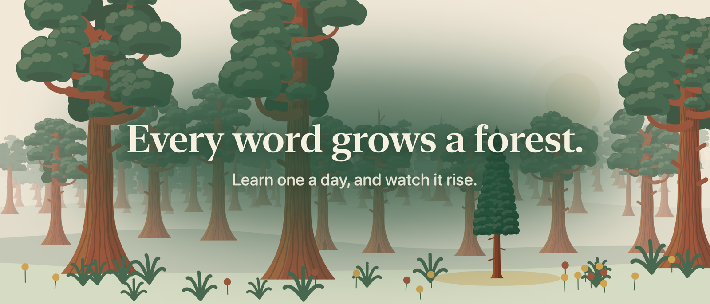
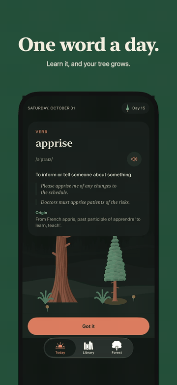
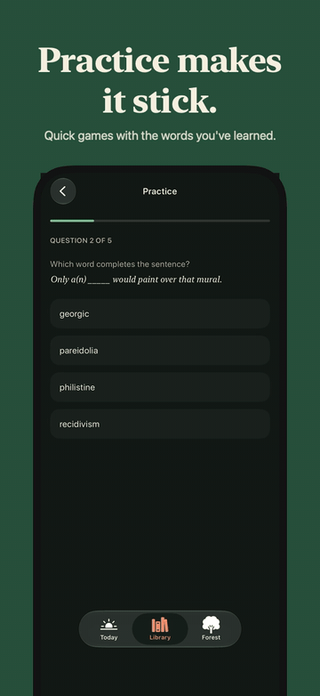
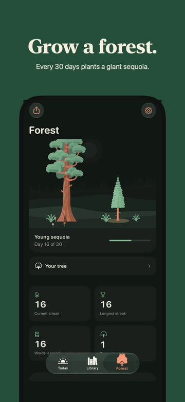
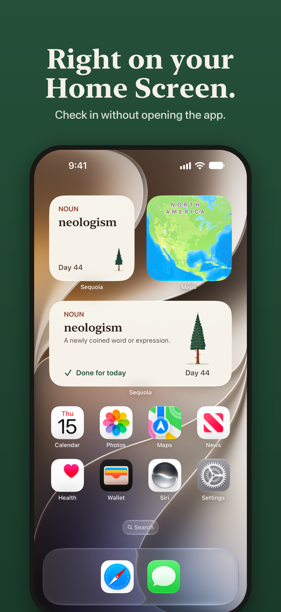
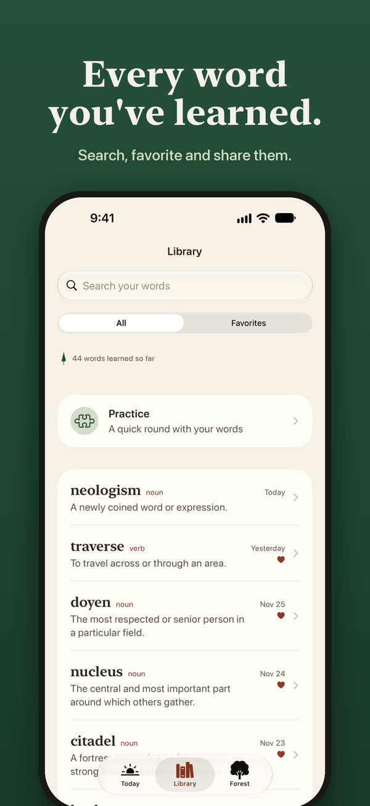
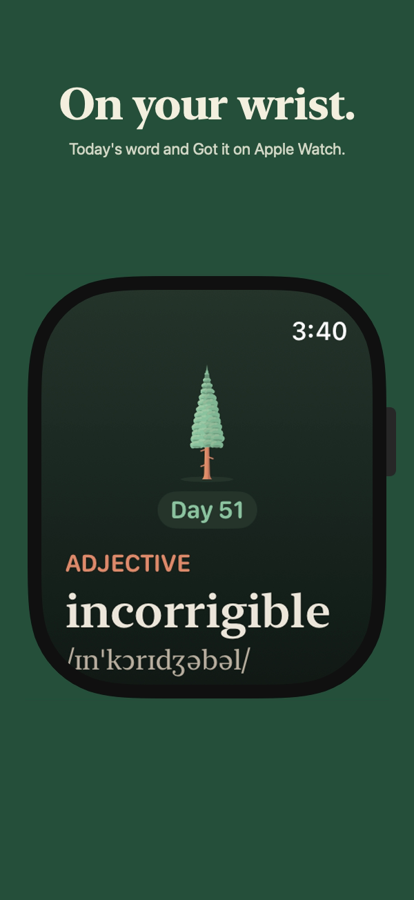

# Sequoia: Word of the Day

**One word a day. Each word you learn grows a sequoia, and 30 days in a row plants it in your forest.**

Free, with no ads or accounts. iPhone, widgets and Apple Watch.
[Project page](https://second-paperback-0e4.notion.site/Sequoia-Word-of-the-Day-3ea075d65b0980d88036d080299d30ad) · [Privacy policy](https://second-paperback-0e4.notion.site/Sequoia-Privacy-Policy-3ff075d65b0980018bf1c352c392aabd) · [Support](https://tally.so/r/bZVk8o)

<table>
  <tr>
    <td></td>
    <td></td>
    <td></td>
  </tr>
  <tr>
    <td></td>
    <td></td>
    <td></td>
  </tr>
</table>

## How it works

Each day brings one word with its pronunciation, a definition, two examples and where it comes from. Tap **Got it** and your tree grows: a sprout on day 1, a sapling on day 7, a young sequoia on day 14 and a grown sequoia on day 30, when it's planted in your forest. Every 7 days in a row earns a rain day that covers a missed day, so one busy day doesn't cost you your tree.

- **Four levels:** Everyday, Elevated, Erudite and GRE, with 5,616 hand-checked words that don't repeat until you've seen them all.
- **Practice:** Definition Match and Fill the Blank use the words you've seen, and the ones you miss come back first.
- **Forest:** a misty grove that follows the time of day, with ferns for practice rounds and wildflowers for favorite words.
- **Library:** every word you've seen, searchable, with favorites and shareable word cards.
- **Everywhere:** Home Screen and Lock Screen widgets with a Got it button, an Apple Watch app with complications, and reminders that keep the word a surprise.
- **Private:** no accounts, analytics or third-party code. Progress stays on your devices and in your own iCloud; Game Center leaderboards are optional.

## Building

**Requirements:** Xcode 26 or later, iOS 17+ (iPhone), watchOS 10+ (optional).

1. Open `Sequoia/Sequoia.xcodeproj` in Xcode.
2. Select the **Sequoia** scheme and an iPhone simulator, then press **Run** (⌘R).

To run on your own iPhone:

1. In Xcode, select the project, then under **Signing & Capabilities** choose your team for each target.
2. Choose your iPhone as the run destination and press **Run**.
3. The first time, trust the developer certificate on the phone: **Settings → General → VPN & Device Management**.

## Testing

- **Tests:** press ⌘U with the Sequoia scheme to run the unit tests, UI tests and package tests. The watch tests use the **SequoiaWatch** scheme.
- **Developer mode** (Debug builds only): **Settings → Developer** lets you simulate days passing or a missed day, grant rain days, mark words as missed in practice, jump tree stages, fill the forest, preview the tree-planting moment, fire a notification now, reload widgets and use mock Game Center friends. A yellow **DEV** badge shows while it's on.

<strong>Full guide to the app</strong>

- **First launch:** two short pages. The first explains the daily word and how each day grows your tree. The second picks your word level, **Everyday**, **Elevated**, **Erudite** or **GRE** (about 1,000 words common in GRE prep, drawn from all three levels), and an optional daily reminder. Your first **Got it** plants a welcome sequoia in your forest. **Reset progress** in Settings brings these pages back the next time you open the app.
- **Today:** today's word with its pronunciation (tap the speaker to hear it), definition, examples and origin. Tap **Got it** to complete the day. Words never repeat until you've seen every word at your level (over 1,800 per level, about five years of daily words). Once the day is done, the heart saves the word to favorites and the share button makes an image card.
- **Your tree:** each day you complete grows the tree, and on day 30 it's planted in your forest with a short celebration. Your forest grows behind today's word. Every 7 days in a row quietly earns a **rain day** (you can hold 2). When a rain day covers a missed day, Today tells you, and your streak and tree keep going. Missing more days than your rain days cover starts a new seed; your forest is never lost.
- **Library:** every word you've seen, newest first. Search by word or definition, or switch to **Favorites**. Tap a word for its full card.
- **Practice** (in Library): once you've seen four words (your fourth **Got it** announces it with a full-screen page), play short rounds of **Definition Match** or **Fill the Blank**. Words you miss come back first in later rounds, each game keeps your best score, and every round grows a fern in your forest.
- **Forest:** your planted trees, with your current and longest streak, words learned, trees planted and a calendar of completed days. **Your trees** lists every tree and the 30 words that grew it. **Friends** (optional) compares streaks and trees with Game Center friends.
- **Settings** (gear icon in Forest): word level, a daily reminder time and an evening streak nudge. Notifications are teasers that keep the word a surprise; tap one to open Today and see the word.
- **Widgets:** add Sequoia to the Home Screen (word and streak widgets) or Lock Screen. The medium widget has a **Got it** button; on the day your tree is fully grown it becomes **Plant your sequoia** and opens the app, so you see the planting there. The watch does the same.
- **Apple Watch:** shows today's word with a **Got it** button, plus watch-face complications. It stays in sync with the iPhone.

